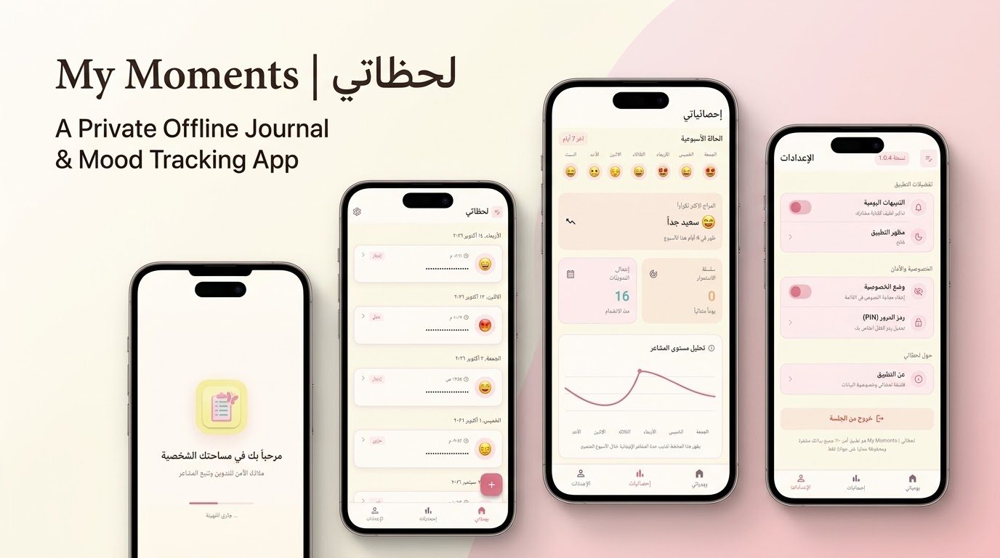
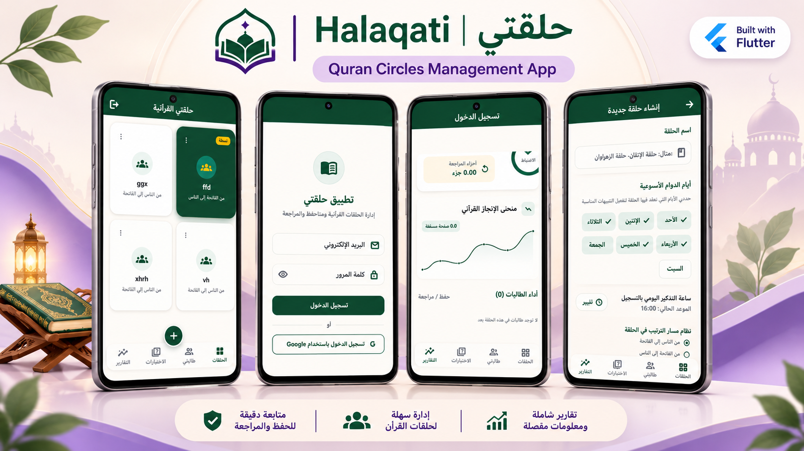

## Hi there 👋

### Flutter Developer | Dart

IT graduate (2024) and Flutter developer interested in building practical, user-focused mobile applications.

### 🛠️ Tech Stack
- **Languages:** Dart, JavaScript, Python
- **Mobile:** Flutter
- **State Management:** Riverpod
- **Database:** Isar, SQLite
- **Backend:** Supabase
- **Tools:** Git, GitHub

### 🚀 Featured Projects

**My Moments**

- Offline-first personal journaling and mood-tracking app.
- Built with Flutter, Riverpod, and Isar.

**Halaqati | حلقتي**

- Quran circles management application.
- Built with Flutter, Riverpod, Drift, and Supabase.
- Currently under development.

### 📫 Connect with Me
- GitHub: [@ItsJee12](https://github.com/ItsJee12)
